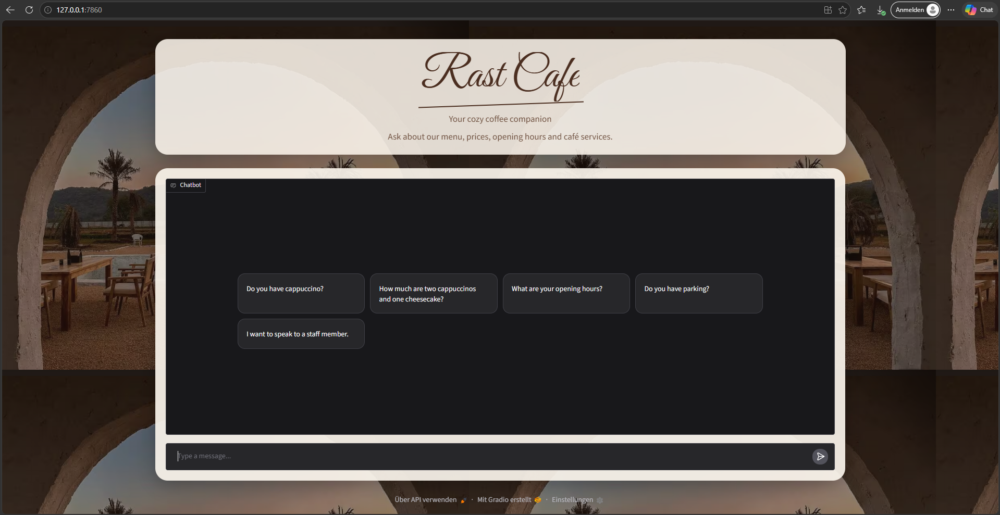
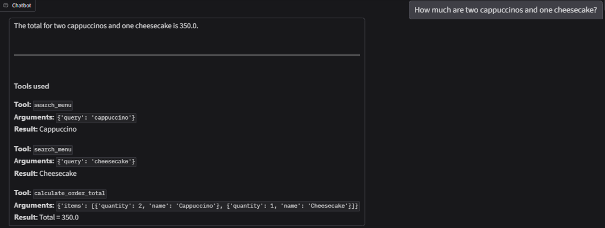
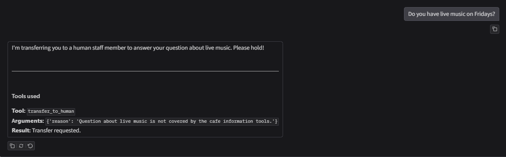

# Rast Cafe: AI Customer Service for Menu, Prices and Cafe Information

Rast Cafe is an AI customer service agent for a fictional cafe. Customers can use it to ask about menu items, prices, availability, opening hours and other cafe information. The agent uses tools and a SQLite database instead of answering from its own memory.

> Course homework: Unit G, My AI Customer Service Agent, with a Database and Tools  
> Student: C115452101 Manuel Rast



## Who It Serves and When They Use It

- **Who uses it:** Customers of Rast Cafe who want information about the cafe, menu, prices or services.
- **When they use it:** Before or during a visit when they want quick information without asking a staff member.
- **What problem it solves:** Customers often ask the same questions about opening hours, menu items, prices, availability, parking and other cafe services. The agent can answer these questions quickly.

## What It Can Do

| Function | Example question | Tool it uses |
|---|---|---|
| Give general cafe information | "What are your opening hours?" | `get_cafe_info` |
| Search for menu items and check availability | "Do you have cappuccino?" | `search_menu` |
| Calculate the total price of an order | "How much are two cappuccinos and one cheesecake?" | `calculate_order_total` |
| Hand over to a person | "I want to speak to the manager." | `transfer_to_human` |

## How It Works

Every question goes to the agent first. The agent chooses a tool, the tool reads the database or calculates in code, and the agent answers only from what the tool returns.

- **Model:** gemini-3.5-flash-lite
- **Chat screen:** Gradio
- **Database (SQLite):** built from the CSV files every time the program starts.

| Table | CSV file | What it holds | Rows |
|---|---|---|---|
| `cafe_info` | `cafe_info.csv` | Topics such as opening hours, address, Wi-Fi, payment and parking | 10 |
| `menu` | `menu.csv` | Drinks and food with category, price and availability | 18 |

- **Tools:**

| Tool | What it does |
|---|---|
| `get_cafe_info(topic)` | Reads one topic from `cafe_info` |
| `search_menu(query)` | Searches for menu items or categories in `menu` |
| `calculate_order_total(items)` | Looks up prices and calculates the total order price in code |
| `transfer_to_human(reason)` | Hands the request over to a staff member when needed |

## Sample Conversations





## Project Files

```text
my-customer-service/
├── app.py              # the agent: database, tools, agent loop and chat screen
├── cafe_info.csv       # the information table
├── menu.csv            # the records table
├── background.png      # background image for the Gradio interface
├── requirements.txt    # the Python packages to install
├── .env.example        # a sample settings file (no real key)
├── .gitignore          # files git must not upload: .env and *.db
├── images/             # screenshots for this README
└── README.md           # this file
```

## How to Install and Run It

1. Download the project:

   ```bash
   git clone YOUR_GITHUB_REPOSITORY_URL
   cd my-customer-service
   ```

2. Install the packages (Python 3.10 or newer):

   ```bash
   pip install -r requirements.txt
   ```

3. Make your settings file. Copy `.env.example` to `.env`, then put your own API key after `API_KEY=`. The model must support tool calling.

   ```bash
   copy .env.example .env      # Windows
   cp .env.example .env        # macOS or Linux
   ```

4. Start the agent. It builds the database from the CSV files, then opens the chat page:

   ```bash
   python app.py
   ```

   On Windows, if `python` does not work:

   ```bash
   py app.py
   ```

5. Open the link shown in the console, usually <http://127.0.0.1:7860>.

## Notes

- All cafe information, menu items and prices in this project are made up for the homework.
- The `.env` file holds the API key. It is **not** included in this repository. A local `.env` file must be created from `.env.example`.
- The agent only answers questions related to Rast Cafe and only uses information returned by its tools.
- If information is not available in the database, the agent can hand the request over to a human staff member.